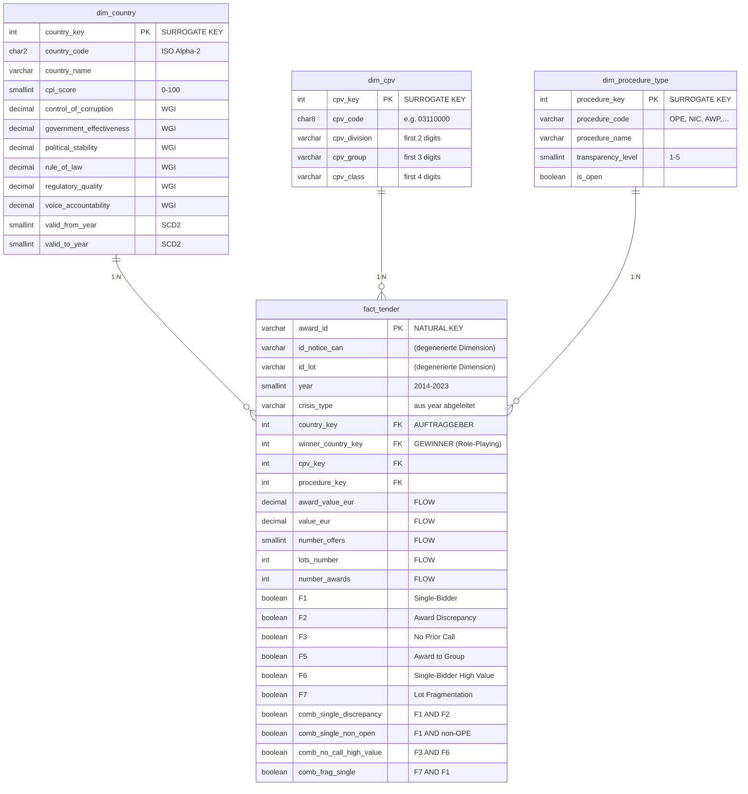

# ME/R Model — Star Schema (Diagram)

**Project:** Red Flags Procurement Governance  
**Format:** [Mermaid.js](https://mermaid.live) — mit der Mermaid-Erweiterung in VS Code (`Strg+Shift+V`) renderbar

---

---

## Legende

| Symbol | Bedeutung |
|--------|-----------|
| `PK` | Primary Key |
| `FK` | Foreign Key (Name identisch mit referenziertem PK) |
| `||--o{` | 1-zu-N-Beziehung (eine Dimension → viele Fakt-Zeilen) |
| `SURROGATE KEY` | Technischer Schlüssel (`INTEGER IDENTITY`, automatisch generiert) |
| `NATURAL KEY` | Fachlicher Schlüssel aus den Quelldaten |
| `degenerierte Dimension` | Referenzattribut ohne eigene Dimensionstabelle |

---

## Design-Merkmale

1. **Kein `dim_time`:** `year` und `crisis_type` sind in `fact_tender` eingebettet (design specification)
2. **Kein `F4`:** Beschleunigtes Verfahren wurde gestrichen (99,16 % NULL)
3. **SCD Type 2:** `dim_country` nutzt `valid_from_year`/`valid_to_year` zur Versionierung von Governance-Scores
4. **FK-Namen = PK-Namen:** `country_key` in `fact_tender` referenziert `country_key` in `dim_country`

---

*Diagramm erstellt 2026-05-17 mit Mermaid.js — rendert in VS Code, mermaid.live, GitHub, GitLab.*
