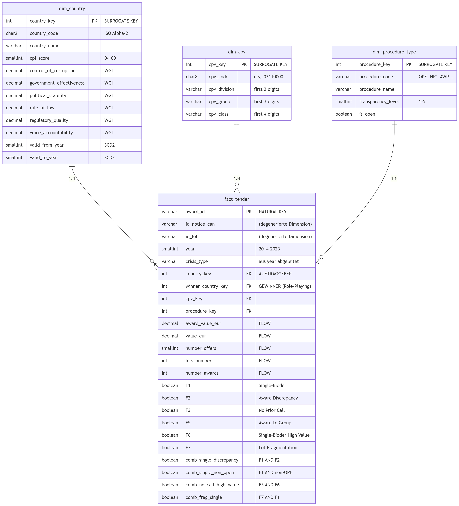

# Challenge 3: Datenmodellierung und Datenimport

**Name:** Johannes Ramser
**Matr.Nr.:** [redacted]

---

Mehrdimensionale Analyse von Auffälligkeiten in EU-Vergabedaten (TED)
mit externen Governance‑Scores (CPI/WGI) – Ein Data‑Warehouse‑Ansatz

---

## Staging Area: Tabellen

*DDL der Staging-Tabellen — 1:1-Abbild der bereinigten CSV-Dateien. (Exercise Sheet 3, Exercise 1.3)*

```sql
CREATE TABLE stg_ted (
    ID_AWARD           VARCHAR(100),
    ID_NOTICE_CAN      VARCHAR(100),
    ID_LOT             VARCHAR(100),
    "YEAR"             SMALLINT,
    ISO_COUNTRY_CODE   CHAR(2),
    winner_country     CHAR(2),
    winner_country_raw VARCHAR(500),
    AWARD_VALUE_EURO   DECIMAL(18,2),
    VALUE_EURO         DECIMAL(18,2),
    NUMBER_OFFERS      SMALLINT,
    B_AWARDED_TO_A_GROUP CHAR(1),
    TOP_TYPE           VARCHAR(10),
    LOTS_NUMBER        INTEGER,
    NUMBER_AWARDS      INTEGER,
    cpv_code           CHAR(8),
    F1                              BOOLEAN,
    F2                              BOOLEAN,
    F3                              BOOLEAN,
    F5                              BOOLEAN,
    F6                              BOOLEAN,
    F7                              BOOLEAN,
    comb_single_discrepancy         BOOLEAN,
    comb_single_non_open            BOOLEAN,
    comb_no_call_high_value         BOOLEAN,
    comb_frag_single                BOOLEAN
);
```

```sql
CREATE TABLE stg_cpi (
    country_iso3  CHAR(3),
    "YEAR"        SMALLINT,
    cpi_score     SMALLINT
);
```

```sql
CREATE TABLE stg_wgi (
    country_iso3            CHAR(3),
    "YEAR"                  SMALLINT,
    control_of_corruption   DECIMAL(5,2),
    government_effectiveness DECIMAL(5,2),
    political_stability     DECIMAL(5,2),
    rule_of_law             DECIMAL(5,2),
    regulatory_quality      DECIMAL(5,2),
    voice_accountability    DECIMAL(5,2)
);
```

---

## Formen der Heterogenität

*Welche Formen von Heterogenität bestehen zwischen TED und CPI/WGI? (Exercise Sheet 3, Exercise 1.4)*

### 1. Technische Heterogenität

TED und CPI werden als CSV-Dateien per HTTP-Download bezogen. WGI hingegen wird über eine REST API (`wbgapi`) abgefragt und liefert eine JSON-Antwort.

> **Bewertung:** Es besteht technische Heterogenität — die Zugriffsprotokolle (HTTP-Download vs. REST API) und die Übertragungsformate (CSV vs. JSON) unterscheiden sich.
>
> **Lösung:** Die Unterschiede werden im Akquisitionsschritt gekapselt. Jede Datenquelle hat ein eigenes Download-Modul, das die rohen Daten in ein einheitliches CSV-Format überführt. Die nachgelagerte ETL-Pipeline verarbeitet nur diese vereinheitlichten CSV-Dateien — die ursprüngliche technische Heterogenität ist für sie transparent.

### 2. Data-Model-Heterogenität

TED und CPI liegen in einem tabellarischen Datenmodell vor: Jede Zeile entspricht einem Datensatz, jede Spalte einem Attribut. WGI liefert nach dem API-Aufruf eine hierarchische JSON-Struktur mit verschachtelten Objekten.

> **Bewertung:** Es besteht Data-Model-Heterogenität — das flache, relationale Modell von TED/CPI steht dem hierarchischen JSON-Modell von WGI gegenüber.
>
> **Lösung:** Der Akquisitionsschritt für WGI extrahiert die relevanten Felder aus der JSON-Hierarchie und flacht sie in eine tabellarische Struktur ab (eine Zeile pro Land-Jahr-Indikator). Nach diesem Schritt liegen alle drei Quellen als flache Tabellen vor und können einheitlich weiterverarbeitet werden.

### 3. Syntaktische Heterogenität

TED enthält große Dezimalzahlen (`DECIMAL(18,2)` für Euro-Beträge) und Booleans (Red Flags). CPI verwendet Ganzzahlen (`SMALLINT`, 0–100 für den Korruptionsscore). WGI liefert sechs normalisierte Dezimalwerte (`DECIMAL(5,2)`, Wertebereich ca. −2,5 bis +2,5).

> **Bewertung:** Es besteht syntaktische Heterogenität — die Datentypen der Attribute sind grundverschieden. Ohne Harmonisierung würde `AVG(AWARD_VALUE_EURO)` und `AVG(cpi_score)` im gleichen Query unterschiedliche numerische Präzision liefern.
>
> **Lösung:** Die Typkonvertierung erfolgt zentral in der ETL-Pipeline — jedem Quellattribut ist ein Exasol-Zieldatentyp zugeordnet. Die einheitlichen Typen im Staging- und Star-Schema stellen sicher, dass abfrageübergreifende Operationen mit konsistenter Präzision arbeiten.

### 4. Semantische Heterogenität

TED verwendet ISO Alpha-2 zur Länderkodierung: `ISO_COUNTRY_CODE = 'DE'`, `'DK'`, `'RO'`, `'HU'`. CPI und WGI verwenden dagegen ISO Alpha-3: `country_iso3 = 'DEU'`, `'DNK'`, `'ROU'`, `'HUN'`. Ohne Mapping würde `WHERE country = 'DE'` nur TED-Zeilen finden, aber keine CPI/WGI-Zeilen.

> **Bewertung:** Es besteht semantische Heterogenität — derselbe reale Sachverhalt (ein Land) wird mit unterschiedlichen Kodierungssystemen repräsentiert.
>
> **Lösung:** Eine Lookup-Tabelle (`lookup_countries.csv`) enthält das bidirektionale Mapping Alpha-2 ↔ Alpha-3 für alle vier untersuchten Länder (DE, DK, RO, HU). Im ETL-Prozess wird sie für den Länderfilter auf TED sowie für den Join zwischen TED und CPI/WGI verwendet. Im Star-Schema wird der einheitliche Alpha-2-Code in `dim_country.country_code` gespeichert.

### 5. Strukturelle Heterogenität

| Aspekt | TED | CPI | WGI |
|--------|-----|-----|-----|
| Spalten (roh → bereinigt) | 75 → 25 | 10 → 3 | 8 (via API) |
| Granularität | Pro Auftrag (`ID_AWARD`) | Pro Land-Jahr | Pro Land-Jahr |
| Zeilenanzahl | ~1,78 Mio. (nach Dedup) | 40 (4 Länder × 10 Jahre) | 40 (4 Länder × 10 Jahre) |

Die strukturellen Unterschiede zeigen sich in drei Dimensionen: Die Spaltenanzahl differiert stark (TED 25, CPI 3, WGI 8). Die Granularität ist inkompatibel — TED arbeitet auf Auftragsebene (~1,78 Mio. Zeilen), CPI und WGI auf der aggregierten Land-Jahr-Ebene (je 40 Zeilen). Die Zeilenanzahlen liegen um den Faktor ~44.000 auseinander.

> **Bewertung:** Es besteht strukturelle Heterogenität auf allen drei Ebenen — Spaltenstruktur, Granularität und Datenvolumen sind grundverschieden.
>
> **Lösung:** Die Integration erfolgt über ein Star-Schema mit `dim_country` als SCD Typ 2. Die Governance-Scores (CPI/WGI) werden in der Länderdimension versioniert (`valid_from_year`/`valid_to_year`). Beim Join mit `fact_tender` werden die Scores über das passende Land-Jahr-Intervall auf jede Auftragszeile repliziert — so entsteht eine einheitliche Granularität auf Auftragsebene.

### 6. Schematische Heterogenität

Die Namenskonventionen unterscheiden sich systematisch: TED verwendet Großbuchstaben mit Unterstrichen (`ISO_COUNTRY_CODE`, `AWARD_VALUE_EURO`), CPI und WGI verwenden Kleinschreibung mit Underscores (`country_iso3`, `cpi_score`). Auch die Schlüsselstrategien differieren: TED besitzt einen expliziten natürlichen Primärschlüssel (`ID_AWARD`), während CPI und WGI einen impliziten, zusammengesetzten Schlüssel aus `country_iso3` und `year` nutzen.

> **Bewertung:** Es besteht schematische Heterogenität — sowohl die Benennung der Attribute als auch die Definition der Primärschlüssel folgen unterschiedlichen Konventionen.
>
> **Lösung:** Das Star-Schema definiert eine eigene, einheitliche Namenskonvention (Kleinschreibung mit Underscores, z. B. `award_value_eur`, `country_code`). Alle Quellattribute werden im ETL-Prozess auf diese Zielnamen gemappt. Die unterschiedlichen Schlüsselstrategien werden durch Surrogatschlüssel (`INTEGER IDENTITY`) in den Dimensionstabellen vereinheitlicht — `country_key` ersetzt sowohl `ISO_COUNTRY_CODE` als auch `country_iso3`.

---

## Schema Matching

*Welche Attribute aus TED korrespondieren mit welchen aus CPI/WGI? (Exercise Sheet 3, Exercise 1.5)*

### TED → CPI Schema Matching

| TED-Attribut | CPI-Attribut | Match-Typ |
|---------------|---------------|------------|
| `ISO_COUNTRY_CODE` (Alpha-2: DE) | `country_iso3` (Alpha-3: DEU) | **Semantisch** — unterschiedliche Kodierung, aufgelöst via `lookup_countries.csv` |
| `YEAR` (SMALLINT, 2014–2023) | `year` (SMALLINT, 2014–2023) | **Exakt** — identischer Name, Typ und Wertebereich |
| *(kein CPI-Score in TED)* | `cpi_score` (SMALLINT, 0–100) | **Neues Attribut** — nur in CPI, gejoint über (Land, Jahr) |

### TED → WGI Schema Matching

| TED-Attribut | WGI-Attribut | Match-Typ |
|---------------|---------------|------------|
| `ISO_COUNTRY_CODE` (Alpha-2: DE) | `country_iso3` (Alpha-3: DEU) | **Semantisch** — aufgelöst via Lookup-Tabelle |
| `YEAR` (SMALLINT, 2014–2023) | `year` (SMALLINT, 2014–2023) | **Exakt** — identischer Name, Typ und Wertebereich |
| *(keine WGI-Dimensionen in TED)* | 6× WGI-Scores (DECIMAL(5,2)) | **Neue Attribute** — nur in WGI, gejoint über (Land, Jahr) |

> **Externer Lookup:** Eine Lookup-Tabelle (`lookup_countries.csv`, 4 Zeilen) stellt das bidirektionale Mapping `alpha_2` ↔ `alpha_3` ↔ `country_name` für die vier untersuchten Länder bereit. Sie wird im ETL-Prozess für den TED-Länderfilter, den CPI/WGI-Join und die Ländernamen in `dim_country` genutzt und **nicht** als separate Staging-Tabelle in Exasol importiert.

### CPI → WGI Schema Matching

| CPI-Attribut | WGI-Attribut | Match-Typ |
|---------------|---------------|------------|
| `country_iso3` (CHAR(3)) | `country_iso3` (CHAR(3)) | **Exakt** — identischer Name, Typ und Kodierung |
| `year` (SMALLINT) | `year` (SMALLINT) | **Exakt** — identischer Name, Typ und Wertebereich |
| *(unterschiedliche Scores)* | *(6 Governance-Dimensionen)* | **Verwandt** — beide messen Governance-Qualität, aber auf unterschiedlicher Granularität (CPI: einzelner Korruptionswahrnehmungs-Score; WGI: sechs mehrdimensionale Indikatoren) |

### Integrationsentscheidung

Die drei Quellen werden über ein **Star-Schema** integriert:
- CPI + WGI werden über (country_iso3, year) zusammengeführt und als SCD Typ 2 in `dim_country` gespeichert
- TED-Daten befüllen `fact_tender` mit Fremdschlüsseln auf `dim_country`, `dim_cpv`, `dim_procedure_type`
- Red Flags werden in der Python-ETL-Pipeline vorberechnet und direkt in `fact_tender` gespeichert

**Aggregationstypen der Kennzahlen** (Details in [`measure_table.md`](../../doc/data-model/measure_table.md)):

| Typ | Kennzahlen |
|-----|-----------|
| **FLOW** | `award_value_eur`, `value_eur`, `number_offers`, `lots_number`, `number_awards` — über alle Dimensionen summierbar |
| **VPU** | F1–F3, F5–F7 + 4 Kombinationen — als Rate auszuwerten: `SUM(CAST(flag AS INT)) / COUNT(*)` |
| **STOCK** | CPI/WGI-Scores in `dim_country` — nicht über Zeit summierbar (ein Wert pro Land-Jahr) |

---

## Star / Snowflake Schema

*DDL des finalen Star-Schemas — mit `winner_country` als Role-Playing-FK. (Exercise Sheet 3, Exercise 1.6)*

### Faktentabelle: `fact_tender`

```sql
CREATE TABLE fact_tender (
    award_id           VARCHAR(100)     NOT NULL,
    id_notice_can      VARCHAR(100),
    id_lot             VARCHAR(100),
    "year"              SMALLINT         NOT NULL,
    crisis_type        VARCHAR(50),
    country_key        INTEGER,
    winner_country_key INTEGER,
    cpv_key            INTEGER,
    procedure_key      INTEGER,
    award_value_eur    DECIMAL(18,2),
    value_eur          DECIMAL(18,2),
    number_offers      SMALLINT,
    lots_number        INTEGER,
    number_awards      INTEGER,
    F1                              BOOLEAN,
    F2                              BOOLEAN,
    F3                              BOOLEAN,
    F5                              BOOLEAN,
    F6                              BOOLEAN,
    F7                              BOOLEAN,
    comb_single_discrepancy         BOOLEAN,
    comb_single_non_open            BOOLEAN,
    comb_no_call_high_value         BOOLEAN,
    comb_frag_single                BOOLEAN,
    PRIMARY KEY (award_id),
    FOREIGN KEY (country_key)        REFERENCES dim_country (country_key),
    FOREIGN KEY (winner_country_key) REFERENCES dim_country (country_key),
    FOREIGN KEY (cpv_key)            REFERENCES dim_cpv (cpv_key),
    FOREIGN KEY (procedure_key)      REFERENCES dim_procedure_type (procedure_key)
);
```

- **Eine Zeile pro `ID_AWARD`** (Deduplizierung unter Berücksichtigung von CORRECTIONS-Einträgen). `ID_NOTICE_CAN` und `ID_LOT` als degenerierte Dimensionen.
- **Role-Playing:** `dim_country` wird zweimal referenziert — `country_key` (Auftraggeber-Land), `winner_country_key` (Gewinner-Land).
- **Red Flags:** 6 Einzelflags (F1–F3, F5–F7) + 4 Kombinationen. F4 wurde verworfen (99,16% NULL).
- **AWARD_VALUE_EURO:** Sentinel-Entfernung (€10T → NaN) — kein Perzentil-Clipping.
- **Faktentabellen-Typ:** Transactional Fact Table (Vorlesung Folie 20) — eine Zeile pro Vergabeereignis (`ID_AWARD`). Jeder Eintrag repräsentiert einen diskreten Geschäftsvorfall.

### Dimensionstabellen

```sql
CREATE TABLE dim_country (
    country_key        INTEGER IDENTITY NOT NULL,
    country_code       CHAR(2)          NOT NULL,
    country_name       VARCHAR(100)     NOT NULL,
    cpi_score          SMALLINT         NOT NULL,
    control_of_corruption      DECIMAL(5,2) NOT NULL,
    government_effectiveness   DECIMAL(5,2) NOT NULL,
    political_stability        DECIMAL(5,2) NOT NULL,
    rule_of_law                DECIMAL(5,2) NOT NULL,
    regulatory_quality         DECIMAL(5,2) NOT NULL,
    voice_accountability       DECIMAL(5,2) NOT NULL,
    valid_from_year    SMALLINT         NOT NULL,
    valid_to_year      SMALLINT         NOT NULL,
    PRIMARY KEY (country_key)
);

CREATE TABLE dim_cpv (
    cpv_key        INTEGER IDENTITY NOT NULL,
    cpv_code       CHAR(8)          NOT NULL,
    cpv_division   VARCHAR(4),
    cpv_group      VARCHAR(4),
    cpv_class      VARCHAR(4),
    PRIMARY KEY (cpv_key)
);

CREATE TABLE dim_procedure_type (
    procedure_key      INTEGER IDENTITY NOT NULL,
    procedure_code     VARCHAR(20)      NOT NULL,
    procedure_name     VARCHAR(100),
    transparency_level SMALLINT,
    is_open            BOOLEAN,
    PRIMARY KEY (procedure_key)
);
```

---

## IMPORT

*IMPORT-Befehle zum Laden der bereinigten CSV-Dateien in die Staging-Tabellen. (Exercise Sheet 3, Exercise 2.1)*

**Quelldatei-Eigenschaften (von der ETL-Pipeline einheitlich produziert — UTF-8, LF, Komma-getrennt):**

| Eigenschaft | TED CSV | CPI CSV | WGI CSV |
|----------|---------|---------|---------|
| Kodierung | UTF-8 (ohne BOM) | UTF-8 (ohne BOM) | UTF-8 (ohne BOM) |
| Zeilenende | LF (Unix) | LF (Unix) | LF (Unix) |
| Spaltentrenner | `,` (Komma) | `,` (Komma) | `,` (Komma) |
| String-Begrenzer | `"` (doppelte Anführungszeichen) | `"` (doppelte Anführungszeichen) | `"` (doppelte Anführungszeichen) |
| Kopfzeile | Ja (erste Zeile) | Ja (erste Zeile) | Ja (erste Zeile) |
| Dezimalzeichen | `.` (Punkt) | — (Ganzzahlen) | `.` (Punkt) |
| Tausendertrenner | Keiner | Keiner | Keiner |

**Voraussetzung:** Die CSV-Dateien werden vom ETL-Prozess automatisch produziert und im Verzeichnis `data/processed/` abgelegt.

**Fehlertabelle (wird von Exasol automatisch beim ersten `ERRORS INTO` angelegt):**

```
ROW_NR      DECIMAL(18,0)
ERROR_TEXT  VARCHAR(1000) UTF8
TRUNCATED   BOOLEAN
CSV_DATA    VARCHAR(2000000) UTF8
```

> Kein manuelles `CREATE TABLE` nötig — Exasol erzeugt `error_tbl` selbst.

**IMPORT-Skript:**

```sql
OPEN SCHEMA JOHANNES_RAMSER;

IMPORT INTO stg_ted
FROM LOCAL CSV FILE 'C:/Users/Johannes/uni/sose26/dw/red-flags-procurement-governance/data/processed/ted/ted_clean.csv'
ENCODING = 'UTF-8'
ROW SEPARATOR = 'LF'
COLUMN SEPARATOR = ','
COLUMN DELIMITER = '"'
SKIP = 1
ERRORS INTO error_tbl REJECT LIMIT UNLIMITED;

IMPORT INTO stg_cpi
FROM LOCAL CSV FILE 'C:/Users/Johannes/uni/sose26/dw/red-flags-procurement-governance/data/processed/cpi/cpi_clean.csv'
ENCODING = 'UTF-8'
ROW SEPARATOR = 'LF'
COLUMN SEPARATOR = ','
COLUMN DELIMITER = '"'
SKIP = 1
ERRORS INTO error_tbl REJECT LIMIT UNLIMITED;

IMPORT INTO stg_wgi
FROM LOCAL CSV FILE 'C:/Users/Johannes/uni/sose26/dw/red-flags-procurement-governance/data/processed/wgi/wgi_clean.csv'
ENCODING = 'UTF-8'
ROW SEPARATOR = 'LF'
COLUMN SEPARATOR = ','
COLUMN DELIMITER = '"'
SKIP = 1
ERRORS INTO error_tbl REJECT LIMIT UNLIMITED;

SELECT 'stg_ted' AS "table", COUNT(*) FROM stg_ted
UNION ALL SELECT 'stg_cpi', COUNT(*) FROM stg_cpi
UNION ALL SELECT 'stg_wgi', COUNT(*) FROM stg_wgi;
SELECT COUNT(*) AS import_errors FROM error_tbl;
```

---

## Zahlen & Größen

| Tabelle | Zeilen | CSV | Exasol RAW (Nutzdaten) | Exasol MEM (mit Overhead) |
|-------|------|-----------------|------------------------|--------------------------|
| `stg_ted` | 1.784.558 | 231,39 MB | 151,44 MB | 65,27 MB |
| `stg_cpi` | 40 | 0,50 KB | 440 B | 13,6 KB |
| `stg_wgi` | 40 | 2,86 KB | 1,0 KB | 30,8 KB |
| `error_tbl` | 0 | — | 0 B | — |
| `dim_country` | 2 | — | 94 B | 48,1 KB |
| `dim_cpv` | 2 | — | 50 B | 30,8 KB |
| `dim_procedure_type` | 2 | — | 75 B | 23,9 KB |
| `fact_tender` | 2 | — | 261 B | 95,9 KB |
| **Gesamt** | **1.784.642** | **~231,39 MB** | **~151,44 MB** | **~65,50 MB** |

- **Größte Tabelle (Zeilen + Größe):** `stg_ted` (1.784.558 Zeilen, 231,39 MB CSV / 151,44 MB Exasol RAW)
- **Fehlertabelle:** `error_tbl` — 0 Zeilen (fehlerfreier IMPORT), 0 B RAW
- **Faktentabelle:** `fact_tender` — konzeptionell die größte Star-Schema-Tabelle; aktuell 2 Beispielzeilen, wird aus `stg_ted` befüllt

---

## ME/R Modell


